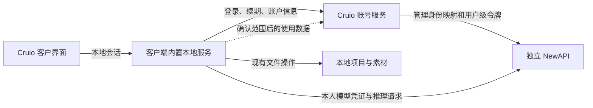

# Cruio 账户体系改造方案

更新日期：2026-11-03  
状态：第一版范围已收敛；早期探索保留在后文，不能作为新增开发要求  
依据：[Cruio V1 工作大纲](./references/workOutline.md)与[账号及模型接入探索报告](./references/explorationReport.md)

## 第一版定稿范围

第一版完成一条流程：运营先在 NewAPI 开通用户、创建并配置 Key，再创建 Cruio 账号并填写 Key，客户登录后直接创作；运营能够处理无法登录、模型未开通和账号停用。不增加新的计费系统或创作页面。

| 使用方 | 必须有的功能 | 简化方式 |
| --- | --- | --- |
| 客户 | 账号密码登录、退出、会话失效后的重新登录 | 运营开通，无公开注册；密码至少 6 位，不增加复杂字符组合要求 |
| 客户 | 我的账户：查看身份和模型服务状态 | 复用设置面板，身份只读；不新增个人资料编辑页 |
| 客户 | 登录后使用本人 Key，继续打开和保存本地项目 | 客户不填 NewAPI 地址或 Key；未开通模型时说明原因，不借用共享密钥 |
| 客户 | 退出、切换及失效时处理未保存内容，清理旧账户上下文 | 复用现有文档、画布保存能力；退出不删除本地文件 |
| 运营 | 管理员登录、账户列表、搜索、新建账号、启停、重置密码、撤销 Cruio 会话 | 沿用 4310 账户服务的 `/admin`，只设普通账户和管理员两类角色 |
| 运营 | 绑定、更换或解除 NewAPI API Key，查看绑定状态 | 新建账号时可直接填 Key；一个 Key 不重复绑定多个账号；不填写 NewAPI 用户 ID 或地址 |
| 运营 | 在已有 NewAPI 后台配置 Key 的模型权限和额度 | Cruio 不另建模型允许清单；Key 加密且不回显，更换/解除时撤销 Cruio 会话 |

账户后台只需登录、账户列表、新建账户、账户详情四个页面。详情集中展示 API Key 绑定、账户状态和密码重置；不增加仪表盘、统计图表或多层管理导航。首次管理员通过本机运营命令授权，之后日常开通与维护在页面完成。

### NewAPI 绑定的边界

- 运营线下开通 NewAPI 用户、创建 Key，并在 NewAPI 中配置全部模型权限，再到 Cruio 创建账号、填写 Key 完成绑定。
- Cruio 不调用 NewAPI 用户管理接口，不核验或同步用户信息，不要求填写管理令牌、用户 ID、实例地址或模型清单。模型调用地址沿用已有部署配置。
- 绑定只表示 Key 已保存，不代表上游鉴权和生成已成功验证；同一个 Key 不能重复绑定其他 Cruio 账号。
- 更换或解除 Key 会撤销 Cruio 会话；NewAPI 中 Key 的权限、额度、停用与撤销均由运营手动处理。
- 客户端显示已适配模型目录，调用是否获准由 NewAPI 判断，Cruio 不再维护账户模型白名单。

### 视觉范围

客户登录沿用已选第二张[创作入口](./visuals/creativeLogin.png)，账户面板与异常提示复用已有深浅主题，详见[账户页面设计](./screenDesign.md)。运营后台使用浅色表格与详情分区，绿色强调主操作、文字标注状态；视觉以[实际页面预览](./adminPreview.jpg)为准。两类界面各自保持一致，不为首版新增主题切换或品牌系统工程。

### 第一版不做

公开注册、短信/社交登录、自助找回密码、头像及资料编辑；团队、组织与自定义角色；余额看板、充值支付、订单、套餐及独立账本；自动创建或同步 NewAPI 账户、自动发放或撤销上游令牌；项目云同步、使用数据上传、旧数据自动迁移、多人 Web 和自研模型网关。跨客户端重启的持久登录暂不承诺，当前重启后重新登录。

身份鉴权、权限检查、密码哈希、保存失败处理与账户切换隔离属于必要保障，不因“最小版本”删除。真实模型调用联调、正式协议及帮助地址、安装包真机验证属于交付配置与验证事项，不因此新增产品功能。

### 完成判断与证据

设计完成须具备：上述客户与运营功能清单、四页后台结构、NewAPI 关联规则、选定视觉、明确排除项与实际交付边界。本目录已覆盖这些设计项，运行和权限细节见[账户服务说明](./accountService.md)，客户交互见[产品设计](./productDesign.md)。

设计定稿不等于生产验收。客户链路的历史验证见[验收记录](./acceptanceReport.md)；后台已做隔离环境手动验证与页面查看，实际 Key 的模型调用尚需运营联调。不能将后文的长期恢复、自动撤销或使用数据同步候选能力记为首版已完成。

## 早期探索与扩展候选（历史参考）

以下保留 2026-11-02 的问题分析和候选方案，用于理解改造原因；其中“建议”“尚需确认”及较大的能力清单均以以上第一版定稿范围为准。已确认采用最小独立账号服务、运营后台和手工模型授权，不再重复选型。

Cruio V1 的账户改造应围绕一个完整流程展开：用户使用 Cruio 账号登录，自动取得本人可用的模型能力，在本地创建和保存项目，退出或切换账号后停止使用原账号的凭证和同步上下文。

建议保留桌面客户端与内置本地服务，优先复用已有身份服务；在核实 NewAPI 的用户级凭证能力后，由本地服务直接调用 NewAPI。账户服务负责身份、会话和凭证关联，不默认承担模型流量转发。配置权限与账号切换必须与登录一起交付，不能在只完成登录页面时开放客户使用。

## 1 范围与前提

| 分类 | 内容 |
| --- | --- |
| 已确认要求 | 统一 Cruio 账号；必须登录；客户不填写供应商地址或 API Key；运营配置模型接入；本地保存项目；使用数据按确认的字段同步 |
| 本方案覆盖 | 登录与会话、账号与模型凭证关联、客户与运营权限、配置拆分、账号切换、存量数据处理、实施顺序及验收要求 |
| 保留现状 | 画布、节点、文档、素材及本地文件能力；已有 Cruio 文本与媒体适配；已有路径校验与原子写入保护 |
| 不纳入本次 | 多人 Web 部署、项目与素材云同步、团队协作、自研模型网关、NewAPI 内部改造、完整运营后台、支付与独立钱包、客户 API 产品 |
| 尚需确认 | 身份服务来源、登录方式、NewAPI 实际管理能力、离线使用规则、同步字段、第三方功能开放范围 |

本方案以现有大纲中的桌面模式为基线。若后续增加多人 Web，需要单独设计服务器文件归属和访问授权，不能直接复用桌面的本地目录授权方式。

## 2 当前缺口与对应改造

| 当前实现 | 对账户体系的影响 | 改造要求 |
| --- | --- | --- |
| `helloCompleted` 表示完成引导，`/home` 与 `/workspace` 无统一登录保护 | 完成配置或直接访问路由即可进入创作 | 引导状态与登录状态分离，增加统一会话恢复和路由保护 |
| `main.ts` 在挂载页面前加载完整 settings 与模型信息 | 直接给设置接口加鉴权会让未登录启动失败，登录页无法出现 | 改为先加载公开启动信息和恢复会话，再加载账户设置、模型目录与项目列表 |
| `settings/get` 返回完整配置，`settings/save` 完整覆盖全局设置 | 凭证进入页面，客户可修改平台配置 | 客户接口只读取和保存白名单个人字段，平台配置与凭证单独管理 |
| 文本与媒体从全局配置读取凭证 | 切换账号后仍可能使用前一账号凭证 | 公共调用入口从可信会话取得用户级凭证，执行过程中固定账户上下文 |
| Pinia 持久化落入共享 `settings.stores` | 项目列表和偏好默认不区分账号 | 按账号存储本地偏好和最近项目，退出时清理内存状态 |
| 全局素材目录、按目录区分的临时媒体任务 | 账户切换后可能残留列表、任务结果和订阅 | 明确本机素材策略；任务及订阅绑定创建时的账号与会话 |
| 来源检查、MCP 令牌、设备配对分别保护不同入口 | 不能证明 Cruio 客户身份 | 保留原有边界检查，同时增加 Cruio 会话检查及能力授权 |

源码依据：`apps/web/src/router/index.ts`、`apps/web/src/stores/hello.ts`、`apps/web/src/main.ts`、`apps/web/src/stores/settings.ts`、`apps/server/src/app.ts`、`apps/server/src/routes/settings/`、`apps/server/src/utils/ai/index.ts`、`apps/server/src/utils/media/`、`apps/server/src/utils/assets/index.ts`。更完整的现状证据见探索报告第 3 节。

## 3 身份与模型服务的职责

### 3.1 建议结构

图中的 NewAPI 令牌管理链路须先核实实际部署能力。运营可先通过现有受控工具准备账号映射，不要求首版新建管理控制台。

| 部分 | 负责 | 不负责 |
| --- | --- | --- |
| 客户界面 | 登录交互、账户展示、创作和允许修改的个人偏好 | 保管管理密钥、决定角色、自行指定云端数据所属用户 |
| 桌面宿主与本地服务 | 安全保存客户端凭证、恢复会话、本地接口鉴权、按身份获取模型凭证、执行文件与模型操作 | 充当可信的云端管理员、决定最终余额或额度 |
| Cruio 账号服务 | 识别用户、管理会话与停用状态、维护 NewAPI 映射、授权凭证发放、保存约定的使用数据 | 重建 NewAPI 渠道与模型调度 |
| NewAPI | 现有模型服务、令牌校验及已核实的限额和计量能力 | 代替客户端的本地文件权限或账户切换处理 |
| 运营工具 | 建号或邀请、停用、配置模型与必要限额、排查映射失败 | 作为普通客户可开启的隐藏菜单 |

### 3.2 账号来源

优先接入已有 Cruio 身份服务及其登录、找回密码能力。如果没有现成服务，再单独确定最小账号服务的部署位置与数据库，沿用现有工程约定，不预先新增框架或完整后台。

首版建议只采用一种登录方式。若没有既有注册流程，可选择运营建号或邀请开通，配合安全的初始密码设置或重置流程；这属于待确认建议，不默认开放公开注册、短信、社交登录等多种入口。

客户身份始终以稳定的 Cruio `userId` 表示。若底层复用其他身份提供方，保存其身份映射，不将邮箱、昵称或 NewAPI Key 当作业务主键。选择密码登录时，密码校验与安全哈希由云端身份服务负责，客户端不落盘保存密码。

### 3.3 NewAPI 身份映射与直连条件

建议优先评估“一位 Cruio 用户对应一个 NewAPI 用户、同一用户可有多个受限令牌”。这样较容易对齐个人用量、账号停用和设备会话。若现有 NewAPI 的令牌级隔离已足够，也可采用令牌映射，不为统一结构强制创建额外账号。

选择直连前必须核实以下能力：

- 能创建、停用或撤销用户级调用凭证，并明确失效传播时间。
- 文本、图片、视频等开放能力都能归属正确用户，相关任务查询也遵守归属限制。
- 对外宣称的模型限制和额度能在 NewAPI 侧执行；仅客户端过滤模型列表不能作为安全限制。
- 能取得满足首版需要的用量记录；缺少某类媒体记录时，不能用客户端统计冒充结算数据。

会话与 NewAPI 凭证应建立关联。若支持每设备或每会话令牌，退出当前设备时只撤销对应令牌；停用账号时撤销该账号的全部会话与调用凭证。采用共享的用户令牌时，必须明确撤销会影响该用户的其他设备。

管理凭证只保存在可信云端或运营环境。用户级模型凭证只交给客户端受控运行时，不能通过设置接口回显给页面，也不写入项目、日志或安装包。客户端持有的个人令牌仍可能被设备所有者提取，因此其权限和额度必须在 NewAPI 侧约束。

如果实际部署不满足必要的隔离与撤销要求，应先调整可交付范围或另行确认接入方式，不能退回全部客户共用高权限 Key，也不自动新增云端模型代理。

## 4 登录与会话流程

### 4.1 启动与登录

1. 启动本地服务，加载最少的公开启动信息。未登录时仅开放登录所需接口、静态资源和必要的桌面就绪通知，不读取完整 settings。
2. 桌面宿主从平台安全存储读取恢复凭证，由本地服务向账号服务恢复会话。界面等待恢复结果后决定进入登录页还是项目页，避免先显示旧账号内容。
3. 未登录或恢复凭证明确失效时显示 Cruio 登录页。取消原引导的“稍后配置”等绕过路径；`helloCompleted` 不参与鉴权。
4. 登录成功后，服务端返回当前用户和权限；本地服务建立本地会话，取得对应模型凭证及可用模型目录。
5. 加载该账号的个人偏好和最近项目，直接进入项目流程，不再要求客户填写供应商地址与 Key。

若 Cruio 登录成功但模型账户尚未开通，保留账户登录状态，显示“模型服务尚未开通，请联系运营”；不能要求客户自行配置供应商，也不能借用其他用户凭证。

### 4.2 凭证与接口保护

区分三类凭证：Cruio 云端会话凭证、本地界面访问本地服务的会话凭证、NewAPI 模型调用凭证。三者用途不同，不能用一个 Key 替代所有身份检查。

长期恢复凭证使用桌面平台合适的安全存储；具体与当前桌面运行时的接入方式在实施前验证。短期访问凭证优先仅存于受控内存。安全存储不可用时明确提示并要求重新登录，不静默回退到项目文件、明文 settings 或浏览器持久化存储。

本地会话通过受保护 Cookie 或桌面宿主通道交付，具体方式按运行时能力确定；继续校验来源、Host 和必要的防跨站请求条件。现有自定义请求头与 CORS 本身不能证明已登录。云端服务从经过验证的会话取得用户身份，忽略客户端声称的 `userId` 和角色。

会话需支持到期、续期、主动撤销和账号停用；长期凭证轮换、登录失败限流及重置凭证后的会话处理优先复用身份服务。云端请求不得仅凭客户端缓存的角色授权。

### 4.3 失效与断网

| 情况 | 建议行为 |
| --- | --- |
| Cruio 会话可续期 | 合并并发续期操作，成功后继续；不得自动重放已可能提交成功的付费生成请求 |
| Cruio 会话明确失效 | 停止新的受保护操作，提示重新登录；保留已打开内容，提供受限的保存收尾，避免直接跳转丢失修改 |
| 账号被停用 | 云端拒绝访问，本地在得知停用后锁定新操作；同步撤销 NewAPI 凭证 |
| NewAPI 凭证失效 | 提示模型授权异常并尝试按允许的流程重新取得凭证，不把所有上游 401 都解释为 Cruio 账号退出 |
| 服务暂时不可达 | 显示连接问题，不误删恢复凭证，不把网络错误认定为密码错误 |
| 模型不可用或额度不足 | 显示对应服务错误，不退出 Cruio 登录，不自动重复扣费提交 |

离线规则对应大纲 D10，仍需产品确认。最小建议是每次启动在线恢复会话；运行中断网时，仅在已验证的本地会话有效期内继续本地编辑和保存，禁止需要云端的操作；过期后保留当前文档的保存收尾和重新登录入口。若要求更长离线期限，必须另行定义期限及停用账号无法即时获知的边界。

保存收尾只允许处理失效前已打开的文档与固定目录，不开放新项目、新任务或任意文件操作。具体收尾策略应与离线规则一并确认。

### 4.4 退出与切换账号

1. 停止接收新任务；处理未保存内容，用户取消退出时继续保留当前会话。
2. 暂停自动保存与使用数据上报。将需完成的保存固定在原账号和原目录，完成或明确报告失败后再切换。
3. 终止本地 Agent、文本流、媒体轮询和订阅，按已有取消能力请求停止在途任务。已经提交上游的任务可能继续执行或计费，不能把本地取消当作上游退款。
4. 尝试撤销当前云端会话和关联的 NewAPI 凭证，清除本地会话与安全存储中的对应恢复信息。
5. 清理页面内存中的账户、偏好、项目列表、模型缓存、待发送消息和任务结果，返回登录页。
6. 新账号登录后重新装载其上下文。所有旧异步回调检查原会话标识，不能把结果写入新账号状态。

退出不删除本地项目。原账号的待上传记录保持原归属，只有该账号再次获得授权后才能补传；不能使用新账号凭证上传旧记录。

离线退出必须立即清除本地访问能力，但远端撤销可能暂时失败。需依赖凭证有效期及恢复联网后的可执行撤销机制收敛风险，并准确提示撤销结果；如果产品要求所有情况下即时撤销，则当前直连方案不能承诺该效果。

## 5 权限与配置拆分

### 5.1 权限边界

| 能力 | 未登录 | 已登录客户 | 运营人员 |
| --- | --- | --- | --- |
| 公开启动信息与登录 | 允许 | 允许 | 按实际入口 |
| 本地创作、文件、素材与对话 | 拒绝，受限保存收尾除外 | 允许已授权的本地操作 | 不因运营角色取得客户磁盘访问权 |
| 模型调用与任务访问 | 拒绝 | 仅本人凭证、允许模型及本人任务 | 通过独立受控工具管理服务 |
| 个人偏好与最近项目 | 拒绝 | 仅当前账号 | 不默认开放代改 |
| 平台模型配置、供应商代码调试 | 拒绝 | 拒绝 | 仅可信运营环境 |
| 账号开通、停用和模型授权 | 拒绝 | 拒绝 | 由云端权限决定 |
| 使用数据查询与上传 | 拒绝 | 仅本人且在确认范围内 | 按既有运营权限 |

不把普通桌面客户端改成兼具平台管理能力的程序。运营可以复用现有 NewAPI 控制台和身份管理工具；只有能力缺口明确时再补最少接口。

本地业务接口默认要求登录，公开例外逐项列出。除 `/api` 外，还需检查 `/mcp`、`/a2a`、设备互联、浏览器流和桌面协议触发的业务操作。若这些功能继续开放，应绑定或核查 Cruio 身份；是否关闭入口按大纲 D07 确认，不因账户改造直接删除创作能力。

### 5.2 配置边界

| 配置类别 | 建议位置和访问方式 |
| --- | --- |
| 平台接入配置 | 运营环境管理；客户只能取得公开服务信息及允许模型目录，不可修改 |
| 云端管理密钥 | 云端秘密配置；不下发客户端 |
| 当前账号的恢复凭证和模型凭证 | 安全存储或受控内存；不进入普通 settings 响应 |
| 个人偏好 | 本地按账号划分；仅保存白名单字段，跨设备同步需单独确认 |
| 最近项目和当前项目 | 本地按账号划分；路径不作为普通使用数据上传 |
| 机器级配置 | 保留独立的必要本机设置；是否允许客户修改按字段决定 |

`settings/get` 改为客户配置视图；`settings/save` 改为完整保存当前账号的允许字段，而非完整覆盖系统配置。未知字段和受保护字段应拒绝，响应中也不得回传凭证。个人设置仍可保留“完整快照保存”的语义，不需要因此改成任意部分合并。

前端 `settingsStorage` 只持久化当前账户允许的状态，不能继续把任意 Store 混入全局设置。模型选择组件改为使用无密钥的模型目录，文本和媒体调用在公共执行入口取得凭证；Agent、节点、临时对话及工具调用均使用同一授权规则。

不能通过账号切换时改写全局 `apiKey` 来代替隔离。每个在途调用固定 `userId`、会话标识和凭证引用，状态查询、取消、结果下载及落盘也验证这个上下文。

## 6 数据归属与迁移

### 6.1 最小数据关系

以下是逻辑实体，不要求新建同名表；已有身份服务能够承载时直接复用。

| 实体 | 必要信息 | 归属与约束 |
| --- | --- | --- |
| 账户 | `userId`、显示信息、状态 | Cruio 稳定业务身份，是否允许登录由服务端决定 |
| 登录会话 | `sessionId`、`userId`、有效期、撤销状态、必要设备关联 | 恢复凭证受保护保存；服务端可撤销 |
| 模型身份关联 | `userId`、NewAPI 用户或令牌标识、关联状态 | 可信服务维护，客户不能提交他人的映射 |
| 模型凭证关联 | 会话或设备标识、令牌标识、有效期及状态 | 对齐撤销范围；需要保留的秘密受保护存储 |
| 本地账户配置 | `userId`、个人偏好、最近项目 | 本地命名空间隔离，退出后不装载到其他账号 |
| 使用数据记录 | 稳定记录 ID、事件类型、版本、时间及已确认字段 | 云端按会话绑定用户并去重；不作为金额结算依据 |

登录与模型开通可以分别成功或失败。模型映射应记录“待开通、可用、异常”等必要状态，重复开通请求需先核对已有映射，不能因重试创建重复用户或令牌；错误时不得回退到共享凭证。

### 6.2 本地文件与素材

项目文件继续位于用户选择的本地目录，复用 `useWorkspaceFiles` 及现有路径保护，不自动搬到用户 ID 目录。不同 Cruio 账号在同一台设备上可以由设备使用者手工选择同一目录；这不构成云端数据归属转移，应用登录也不提供磁盘加密。

建议最近项目按账号独立保存；内置素材库的新内容按账号命名空间保存，以避免切换账号后自动展示前一账号素材。已有共享素材作为待迁移本机数据，确认归属后迁移或导入。若希望素材库在本机账户间共享，应明确作为产品策略，不能默认实现后再宣称完全隔离。

### 6.3 使用数据同步

账户方案只定义归属和队列边界，上传字段仍以 D08 确认清单为准。画布、对话正文、文件内容、绝对路径和密钥不进入普通使用数据。推理所需提示词及参考输入仍按模型请求单独处理。

当前 `apps/web/src/lib/anonymousData.ts` 向 Toonflow 遥测地址上报，且在 `main.ts` 初始化。它不是 Cruio 账户同步接口。交付时需明确旧上报的保留或停用策略，并在字段获批后接入 Cruio；不能仅替换 URL 就沿用全部采集字段。

上传失败不影响已经成功的本地保存。队列固定原账号，按稳定记录 ID 去重；账号退出后暂停该账号队列。用量优先读取 NewAPI 已核实的服务端记录，余额和额度不能由客户端上报决定。

### 6.4 存量迁移

1. 变更前备份现有设置及迁移涉及的本机索引，敏感备份留在受保护位置。
2. 提取允许保留的机器设置，剥离旧供应商凭证、旧登录信息和过时引导状态；旧凭证不能自动成为 Cruio 用户凭证。
3. 原项目列表、个人偏好及共享素材先作为待归属的本机存量数据，不自动全部绑定给第一个登录用户。
4. 用户确认导入后，把对应索引和配置归入当前账号，保留项目原路径，不改写已有画布格式标记。
5. 迁移记录版本及完成状态，失败可重试且不重复搬运；未确认成功前不删除源数据。若旧共享模型凭证曾用于客户版本，应由运营轮换或撤销，不能只从界面删除。

## 7 接口与代码改造清单

### 7.1 必要接口能力

下表描述能力契约，具体路径跟随最终身份服务，避免在服务尚未选定时锁死 API。

| 接口能力 | 返回或执行内容 | 核心约束 |
| --- | --- | --- |
| 登录 | 建立当前用户会话 | 限流、统一失败处理；页面不取得长期管理凭证 |
| 恢复及续期 | 验证会话、更新有效期 | 已停用或撤销的会话不可恢复 |
| 当前账户 | 最少的显示信息和允许能力 | 不返回其他用户数据或身份服务内部秘密 |
| 退出 | 撤销指定会话及其凭证关联 | 可重复调用；明确本地退出和远端撤销的结果 |
| 模型接入授权 | 为受控客户端运行时提供用户级调用授权 | 映射由服务端确定，不向普通设置接口返回 Key |
| 可用模型 | 名称、能力、参数及当前可用性 | 不含凭证，调用时仍需校验权限 |
| 个人设置读取与保存 | 当前用户白名单设置快照 | 拒绝系统字段及跨账号写入 |
| 使用数据上传 | 接收已确认记录并去重 | 从会话绑定用户；字段范围确认后实施 |

账号创建、停用及凭证管理优先复用既有运营工具，不默认新增整套管理接口和 UI。本地 Express 路由继续遵守一接口一文件、统一校验和响应格式；云端与本地服务使用相同 `/api` 前缀也不代表属于同一信任边界。

### 7.2 主要代码位置

| 位置 | 必要改造 |
| --- | --- |
| `apps/web/src/main.ts` | 拆分公开启动、会话恢复与账户数据加载，避免未登录启动死锁 |
| `apps/web/src/router/index.ts`、`pages/hello/`、`stores/hello.ts` | 登录页面、路由保护；退出旧模型配置引导 |
| `apps/web/src/stores/settings.ts`、`stores/workspace.ts` | 个人字段与按账号持久化；处理保存队列和切换清理 |
| `apps/web/src/components/settings/`、`lib/tf.ts`、`lib/providerBilling.ts` | 自有账户展示、退出；移除旧账号入口，禁止回退到旧供应商身份 |
| `apps/desktop/src/`、`apps/server/src/app.ts` | 安全凭证桥接、本地会话生命周期、统一接口保护及公开例外 |
| `apps/server/src/routes/settings/`、`utils/conf/` | 系统配置与个人快照分离，切断全局凭证回显和覆盖路径 |
| `apps/server/src/utils/ai/`、`utils/media/` | 用户凭证解析；模型目录与任务授权；在途操作固定上下文 |
| `apps/server/src/agent/`、`utils/singleAgent/` | 传播账户上下文，覆盖 Agent 与工具的间接模型调用 |
| `apps/server/src/utils/assets/`、文件与对话路由 | 本机素材策略、接口登录检查、任务结果访问边界 |
| `apps/web/src/lib/anonymousData.ts` | 核对旧遥测出口，按确认范围接入账户同步 |

账号状态与鉴权逻辑只在前端 Store、服务端所属工具模块及必要中间件中落地，不为本次方案新建通用权限平台。新增文件使用小驼峰。账号云服务的仓库位置在确认已有服务后决定，不与客户端内置 server 混为一谈。

## 8 实施阶段与交付标准

| 阶段 | 工作 | 阶段完成条件 |
| --- | --- | --- |
| P0 确定接入契约 | 明确身份来源、单一登录方式、NewAPI 用户和令牌能力、离线策略 | 得到真实接口与身份映射方案；确认直连可行，列清能力缺口 |
| P1 打通账户会话 | 调整启动顺序，实现登录、恢复、退出、会话失效；增加本地与云端身份校验 | 未登录不能进入创作或直接调用受保护接口；仍能正常打开登录页 |
| P2 绑定模型与配置权限 | 账户模型授权、无密钥目录、设置白名单、公共模型入口授权、用户凭证存储 | 文本及媒体均归属本人；客户不接触平台密钥且不能改平台配置 |
| P3 完成账户切换与迁移 | 账户偏好、最近项目、素材策略、在途任务和保存队列隔离、存量导入 | A 切到 B 后不串凭证、不串任务、不串上传；本地旧项目仍可用 |
| P4 衔接客户流程与同步 | 删除模型配置引导及旧账号入口；按确认字段实施同步 | 登录后直接创作；约定数据进入正确账号；不上传项目正文和秘密 |
| P5 整体验收 | 由软测人员执行账号及创作链路验收 | 完成下列验收场景并记录剩余限制 |

P1 仅完成开发联调阶段，不能单独作为客户发布版本；必须同时具备 P2 的凭证与配置边界及 P3 的切换保护。同步字段未确定时可以继续账户基础工作，但不能宣称整个 V1 数据同步要求已经完成。

验收场景：

- 全新安装、有效会话恢复、错误登录、过期凭证、停用账号、网络不可达。
- 绕过页面直接请求文件、生成、素材、对话、设置、任务接口，均按权限处理。
- 修改设置请求中的系统字段，或尝试旧供应商编辑和调试接口，不能恢复已关闭能力。
- 文本、图片、视频以及 Agent 间接调用都使用正确用户凭证；任务状态和取消不能跨账号。
- A 的保存、防抖、生成和上传未结束时切到 B，不发生跨账号回写或上报。
- 退出和会话失效不删除项目，不静默丢失未保存修改；离线行为符合最终约定。
- 已有项目和素材按确认策略导入，凭证不进入项目、普通配置响应和日志。
- 登录 → 打开本地项目 → 生成 → 保存 → 素材复用全链路可用，客户无需供应商配置。

开发验证使用已有类型检查、构建和必要手动验证，不新增测试模块。探索报告记录的既有类型检查阻塞需在实施时复核，不能用构建通过代替功能验收。本次仅产出方案，不记录这些场景为已通过。

## 9 开发前需要确定的事项

| 优先级 | 对应大纲 | 需要确定的问题 | 建议或影响 |
| --- | --- | --- | --- |
| 账户开发前 | D02、D03、D09 | 是否已有身份服务、数据库和管理工具；采用哪一种登录及找回方式 | 优先复用；没有时只补最小身份能力，不默认完整后台 |
| 模型绑定前 | D04 | NewAPI 实际版本、生产地址、用户及令牌管理、撤销、模型限制、文本与媒体用量归属 | 决定映射粒度及能否直接调用，不能仅凭已有生成成功推断 |
| 会话交付前 | D10 | 每次启动是否必须在线，运行中断网和到期如何处理 | 建议启动在线校验；有效会话内本地编辑，到期保留保存收尾 |
| 数据迁移前 | D12 及本机策略 | 是否继续仅做桌面；同机多个账号是否共享素材库 | 按大纲保留桌面；建议最近项目与新增素材按账号隔离 |
| 客户发布前 | D07 | 外部插件、MCP、远程连接、A2A、开发者能力开放哪些 | 开放入口必须纳入身份链路，不预先批量删除 |
| 同步实施前 | D08 | 使用数据准确字段、触发时机、开关及旧遥测出口策略 | 字段未确定不启用新上传，不默认迁移旧采集清单 |
| 有额度展示要求时 | D06 | 额度权威、用量查询及异常解释方式 | 优先复用已核实的 NewAPI 记录，不自建钱包；充值与客户 API 后续单独确定 |

建议首先完成 P0 的身份服务和 NewAPI 接口核查，形成可直接开发的接口契约，再推进 P1 至 P3。账户页面、鉴权、凭证和数据边界作为同一项改造交付。
