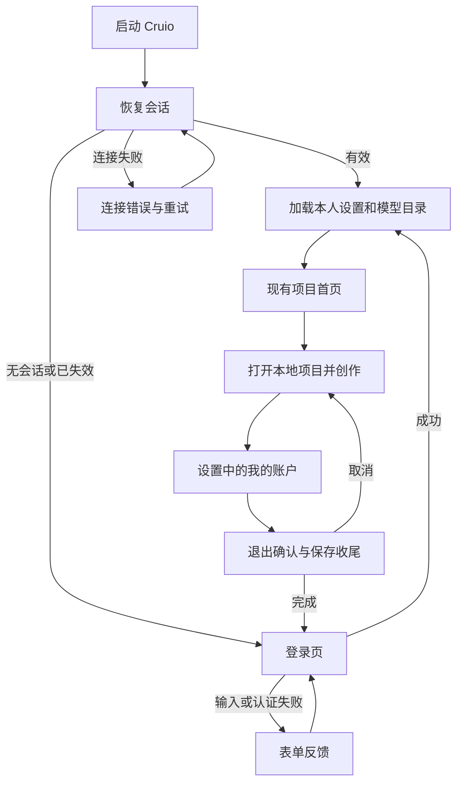

# Cruio 账户产品流程与页面设计

更新日期：2026-11-03。设计稿范围为账户入口及其必要状态，第一版功能边界以[定稿范围](./accountPlan.md#第一版定稿范围)为准，配套[视觉规范](./visualDesign.md)。

用户的主要目标是登录后继续创作。账户页面只提供必要的登录、身份展示与退出交互，平台接入配置留给运营。项目文件继续保存在本机。

## 1 页面与状态清单

| 编号 | 页面或状态 | 承载方式 | 主要任务 |
| --- | --- | --- | --- |
| S01 | 启动恢复会话 | 简洁启动状态 | 确认是否需要登录，不提前显示旧账户内容 |
| S02 | 登录 | 独立页面 | 使用 Cruio 身份进入创作 |
| S03 | 登录错误或暂时不可达 | 登录表单内反馈 | 保留输入、区分输入错误与连接错误 |
| S04 | 登录后首页 | 复用已有项目页面 | 直接选择或打开本地项目 |
| S05 | 我的账户 | 现有设置对话框中的面板 | 查看当前身份及模型服务状态，退出账户 |
| S06 | 模型未开通或授权异常 | 账户面板状态条及模型入口提示 | 解释不可生成原因，不引导客户配置 Key |
| S07 | 会话失效 | 当前工作区上的阻断提示层 | 重新登录并保护尚未保存的内容 |
| S08 | 退出或切换账户 | 确认对话框 | 保存收尾、结束当前会话，避免跨账号状态残留 |
| S09 | 网络中断 | 页内状态条 | 明确可做和不可做的操作，不误判成密码错误 |
| S10 | 账号被停用 | 登录页或当前页面阻断状态 | 停止受保护操作并给出联系路径 |
| S11 | 发现旧版本机数据 | 首次登录后的条件性导入提示 | 确认是否导入原偏好与最近项目，不自动绑定 |
| S12 | 使用数据同步异常 | 仅在确认同步范围后提供的状态提示 | 区分本地保存与使用数据上传 |

S11、S12 仅为历史候选，第一版不实现旧数据导入和使用数据上传。客户忘记密码由运营重置，不增加自助找回、公开注册或账户注销页面。当前认证已确定为账号密码，不再保留多套登录方式选型。

运营侧只新增四页：管理员登录、账户列表、新建账户、账户详情。列表支持搜索与状态筛选；详情放置 API Key 绑定、启停、会话撤销和密码重置，字段与实际操作边界见[账户服务说明](./accountService.md#管理页面与-newapi-key-绑定)。不把运营功能放进客户设置页。

## 2 主要用户流程

模型授权独立于登录结果。未开通模型的用户仍可看到本人账户和按权限允许的本地项目入口；生成入口禁用并说明原因。不能因获取模型列表失败而进入反复登录的循环。

## 3 登录设计

### 3.1 页面内容

第一版使用账号密码登录，账号由运营开通。新建和重置密码至少 6 位，不要求复杂字符组合；客户登录表单不另加更高门槛。

| 元素 | 内容或规则 |
| --- | --- |
| 品牌 | Cruio 文字字标；正式 Logo 后续替换 |
| 标题 | 登录 Cruio |
| 说明 | 登录后，继续你的创作。 |
| 账号 | 显示标签“账号”；占位“输入你的账号”；不预先要求必须是邮箱或手机号 |
| 密码 | 默认隐藏，可临时显示；允许粘贴和密码管理器填充 |
| 主按钮 | 登录；提交中为“正在登录…”并阻止重复提交 |
| 帮助入口 | 无法登录？联系运营；只有真实联系渠道确定后才可交付 |
| 本机说明 | 项目文件保存在本机。 |
| 页脚 | 用户协议、隐私政策；地址和正文待提供，不填虚假链接 |
| 语言 | 复用现有语言选择能力 |

不出现“稍后配置”、游客进入、供应商选择、API Key 输入或 NewAPI 控制台链接。是否需要协议勾选及同意记录应由最终产品与协议要求决定，本轮不凭效果图新增强制勾选行为。

### 3.2 表单状态

| 触发条件 | 反馈 | 后续操作 |
| --- | --- | --- |
| 缺少账号或密码 | 对应字段下方显示“请输入账号”或“请输入密码” | 聚焦第一个缺失字段 |
| 凭证不匹配 | “账号或密码不正确，请重试。” | 保留账号；不透露具体账号是否存在 |
| 请求处理中 | 按钮显示进行中状态 | 不清空表单，不重复发送 |
| 网络不可达 | “暂时无法连接 Cruio，请检查网络后重试。” | 保留输入，允许主动重试 |
| 频率受限 | “操作过于频繁，请稍后重试。” | 有服务端时间时显示实际等待时间，不编造倒计时 |
| 账户被停用 | 经身份服务允许披露时显示“此账号暂时无法使用，请联系运营。” | 无法继续创作，不跳转供应商页面 |

按 Enter 提交；Tab 顺序为账号、密码、密码可见性、登录、帮助及页脚链接。密码可见性按钮需有明确的可访问名称。错误使用文字与状态色一起表达，不只通过红色边框提示。

## 4 登录后的账户入口

首页及工作区继续复用现有设置入口，在设置分类顶部增加“我的账户”。不为账户体系重新设计项目首页，不新增余额卡片、统计看板或订阅营销模块。

“我的账户”建议沿用已有设置对话框结构：160px 分类栏、右侧内容区、约 1080px 最大宽度。内容由身份行、模型服务状态、退出操作组成，三者以留白和分隔线区分。

| 区块 | 展示 | 交互 |
| --- | --- | --- |
| 当前身份 | 服务端返回的显示名称及可展示的账号标识 | 本轮只读，不增加头像上传、昵称编辑或账号绑定 |
| 模型服务 | 可用、尚未开通或授权异常 | 仅异常时显示联系运营或重新检查；可用不等于额度无限 |
| 退出 | 退出登录 | 打开退出确认，不直接清除未保存内容 |

若身份服务没有昵称，使用账号显示标识，不创建“创作者”等伪用户数据。账号标识按真实需求脱敏。NewAPI 用户编号、Token ID、密钥、内部角色名称不出现在普通客户页面。

切换账号通过“退出登录 → 另一账号登录”完成，首版不额外制作多账号列表和一键切换器。

## 5 异常与退出交互

### 5.1 模型服务尚未开通

账户面板显示标题“模型服务尚未开通”，说明“当前账号尚未开通 AI 创作，请联系支持。”主操作为“联系支持”，关闭设置仍可返回允许访问的本地内容。

在生成按钮旁显示同一原因，禁止发起请求。无需同时弹出多个提示，也不能用“去设置 API Key”替代运营开通。开通成功后刷新本人模型目录，继续现有生成流程。

### 5.2 会话失效

保留原文档显示，停止新的受保护操作，显示居中的紧凑对话框：

- 标题：重新登录。
- 说明：请重新登录，继续创作。
- 有未保存内容时补充：当前有未保存的修改，请先不要关闭窗口。
- 主操作：重新登录。
- 有未保存内容时的次操作：保存当前内容。

不承诺未保存内容已写入磁盘或重启后可恢复，也不承诺过期后始终可以保存；保存成功应显示真实结果。对话框不允许通过背景点击恢复已失效的创作权限。

重新登录同一账号后恢复可用操作；登录不同账号前必须完成原内容保存或明确放弃，不能把旧文档状态带入新账号自动上报。

### 5.3 退出确认

标题“退出当前账号？”；基础说明“退出后可重新登录，已保存的项目不会删除。”有未保存修改时改为“有修改尚未保存，要保存后退出吗？”。

| 当前情况 | 操作设计 |
| --- | --- |
| 无未保存修改、无任务 | “取消”和“退出登录” |
| 有未保存修改 | “取消”和“保存并退出”；需明确放弃时提供低强调的“不保存并退出” |
| 保存失败 | 保持当前上下文，显示失败原因与重试；不得自动切换账号 |
| 有生成任务 | 说明正在请求取消，已提交任务可能继续执行；不承诺取消即退款 |
| 退出完成 | 直接返回登录页，不弹出令牌或远端撤销提示；模型凭证的管理留在运营侧 |

账户退出动作本身不使用“删除账户”的危险表达。只有放弃未保存修改这一项使用明显的危险样式。

### 5.4 断网与账号停用

运行中断网采用页内横幅，避免反复打断本地工作。若最后验证的会话仍有效，可按最终离线策略继续本地编辑；模型生成和上传显示暂不可用。会话过期后进入受限保存收尾，不能无限延续离线权限。

账号被停用后显示具体状态，停止新任务；保留本地内容的保存收尾，不提供“跳过验证”。离线策略和停用感知时延必须在开发前确认。

## 6 本机存量数据与同步

旧数据导入是条件性页面，仅发现存量设置或项目索引时出现。标题“发现本机旧版数据”，说明“可将旧版的个人偏好和最近项目导入当前账号。项目文件仍保存在原位置。”提供“选择导入内容”及“暂不导入”；这里的暂不导入不会绕过登录。

默认不勾选全部数据。素材是否单独导入由最终素材共享策略决定；凭证和供应商配置不作为可导入的个人内容。没有旧数据时直接进入首页，不显示空提示。

使用数据同步与项目保存分开表达。只有确认实际上传范围后，才决定是否展示同步状态；不得使用“项目已同步”“云端备份成功”描述仅上传统计记录。

## 7 页面设计验收

- 登录页在没有会话时能够独立显示，不依赖完整设置或模型目录先加载成功。
- 所有页面只出现 Cruio 客户身份，不要求进入 NewAPI 或 TF-Router 登录。
- 登录错误、网络异常、模型授权异常、账号停用使用不同反馈。
- 退出和重新登录时不丢失当前修改，保存失败不会被隐藏。
- 设置账户面板没有平台凭证、供应商编辑或未经确认的充值与钱包内容。
- 方案中的联系人、协议地址、账号样例和状态数据不会在实现时变成虚构的正式内容。
- 文字放大、键盘操作、深浅色和窄窗口均可完成核心流程。

本节为设计及软测验收依据，不代表这些能力已实现或已通过功能测试。
