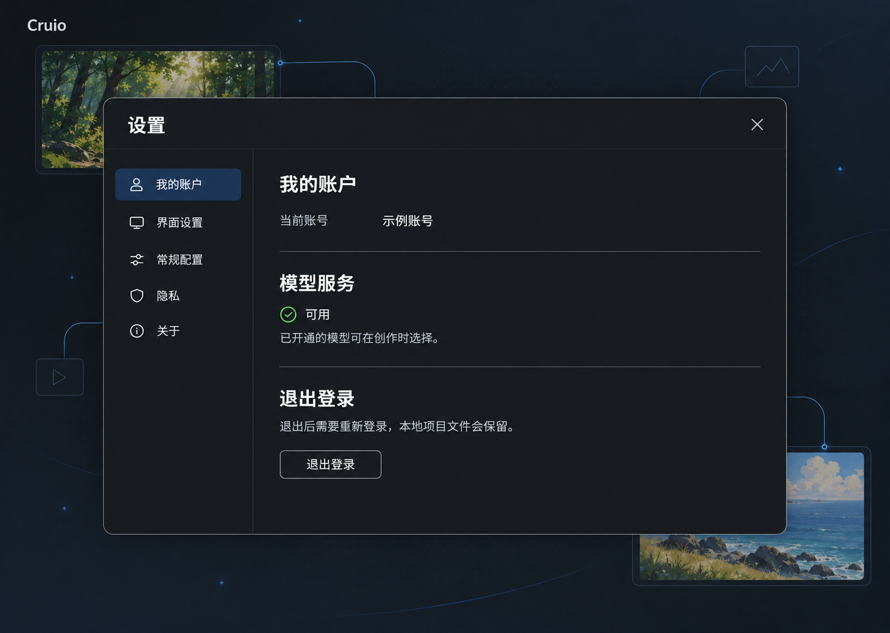
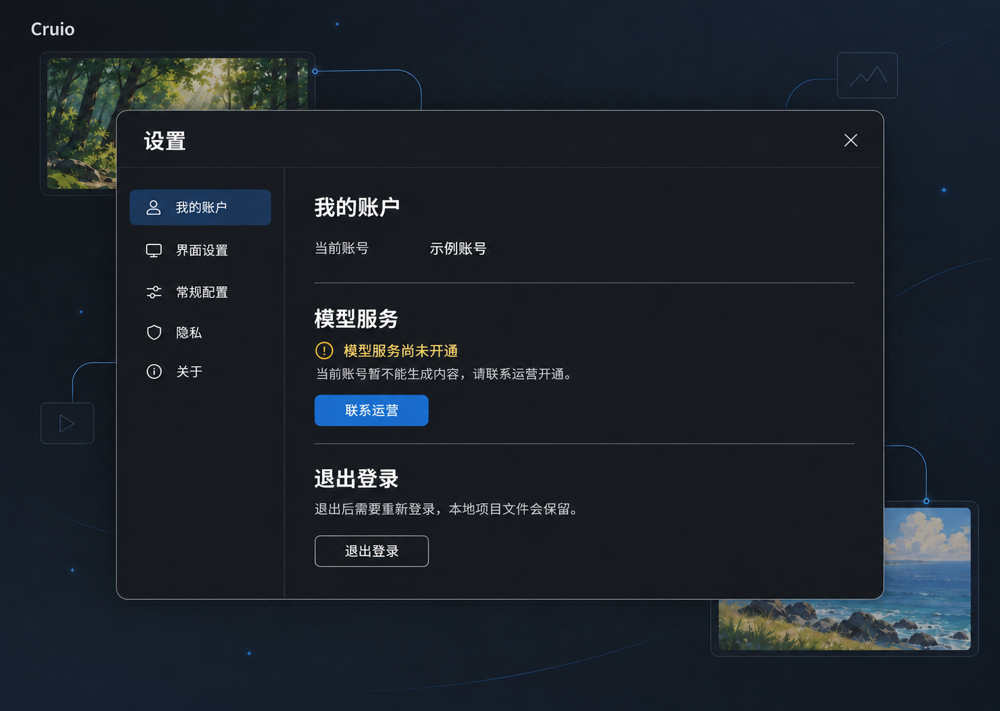
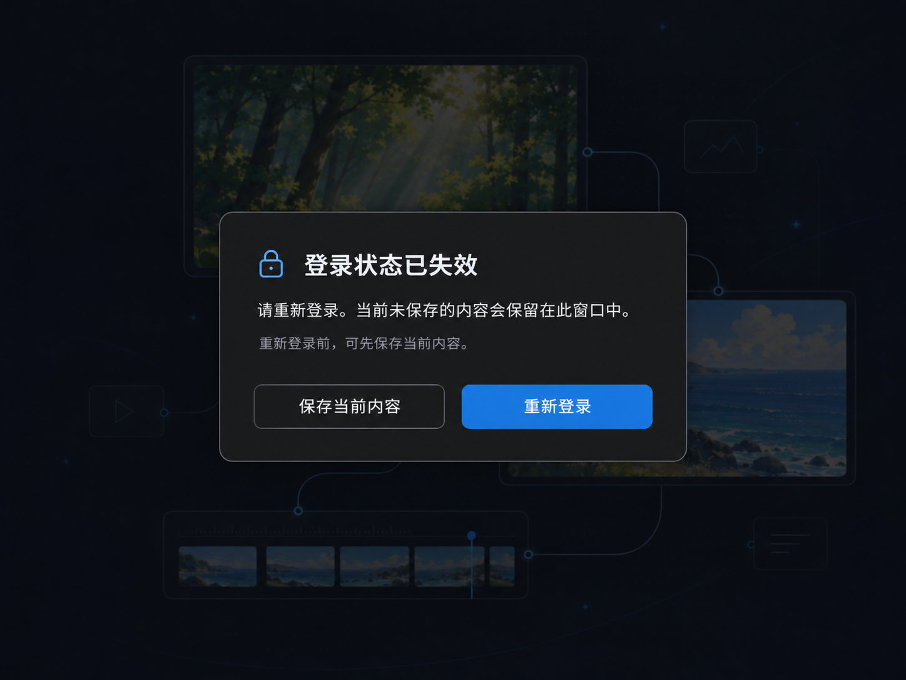
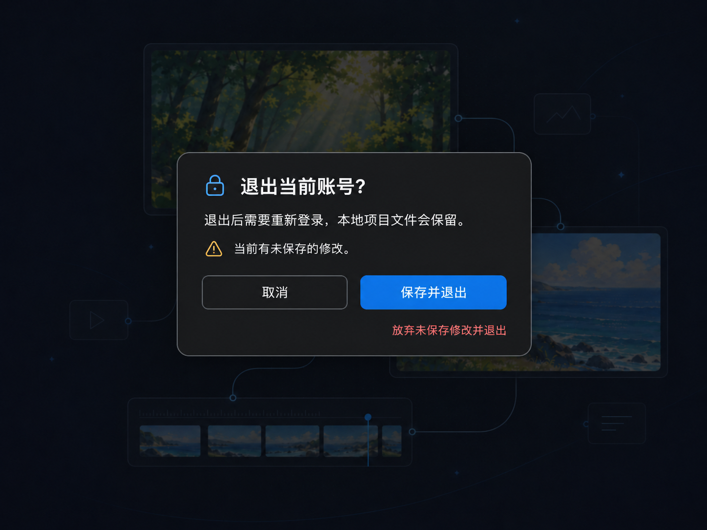

# Cruio 账户页面深化设计

效果图日期：2026-11-02。视觉基线为用户选定的第二张[创作入口](./visuals/creativeLogin.png)。以下四张为设计参考；后续已进入实现，第一版范围及实际限制以 `accountPlan.md`、`accountService.md` 为准。

登录页保留深色分栏和创作插画；账户面板与提示层沿用同一套深色表面、蓝色强调和圆角。效果图中的画布内容仅用于展示叠层关系，不要求重做现有工作区背景。截图中的“示例账号”为显式设计示意，不是真实客户资料。

## 1 我的账户

对应 S05。账户面板放在现有设置对话框内，身份只读。模型服务状态与退出操作分组呈现，不增加钱包、充值、套餐或供应商配置。

| 元素 | 设计要求 |
| --- | --- |
| 分类入口 | “我的账户”位于可见分类顶部；图中其他分类仅为局部示意，不代表批准删除未画出的入口 |
| 当前账号 | 显示身份服务返回的安全展示标识；正式界面不可硬编码“示例账号” |
| 模型服务 | “可用”仅说明已开通，不代表无限额度，也不承诺所有模型均可调用 |
| 退出登录 | 次要描边按钮；点击进入退出确认，不立即清空状态 |
| 关闭设置 | 返回现有创作页面，不改变会话 |

沿用现有设置容器，后续实现按视觉规范中的 160px 分类栏及既有最大宽度落地，不从生成图片反推精确尺寸。

## 2 模型服务尚未开通

对应 S06。沿用同一账户面板，仅改变模型服务区。账号已登录，因此不会跳回登录页，也不会要求客户填写供应商 Key。

主文案为“模型服务尚未开通”，说明为“当前账号暂不能生成内容，请联系运营开通。”唯一主操作是“联系运营”，真实联系渠道待提供。未接入有效渠道前，这张图仅表示预期交互，不应在实现中放置无效按钮。

关闭设置后，可访问已授权的本地内容；生成入口显示同一不可用原因并阻止提交。服务开通后刷新本人目录和授权状态，不借用共享 Key。

## 3 会话失效

对应 S07，展示“当前窗口仍持有未保存内容”的状态。工作区变暗，提示层阻止新创作操作，同时保留受限保存入口。

| 操作 | 行为 |
| --- | --- |
| 保存当前内容 | 仅保存失效前已打开的内容和固定目录；显示真实保存结果，不开放任意文件操作 |
| 重新登录 | 进入认证流程，保留当前窗口中的编辑状态；恢复同一账号后继续操作 |
| 关闭窗口 | 不能把“内容保留在此窗口中”解释为磁盘保存或重启恢复能力 |

没有未保存修改时，不展示保存按钮及相关说明。不同账号重新登录前，先处理原账号修改。图中状态不意味着已确认长时间离线使用；离线策略仍需按 A04 决策。

## 4 退出确认

对应 S08，展示“有未保存修改、没有进行中生成任务”的分支。主操作优先保存，危险操作以单独低强调文字呈现。

| 操作 | 行为 |
| --- | --- |
| 取消 | 关闭对话框，保持当前账号和编辑状态 |
| 保存并退出 | 完成保存后再结束会话；保存失败则留在当前上下文并提示重试 |
| 放弃未保存修改并退出 | 用户明确放弃当前未保存修改后退出，保留已经落盘的项目文件 |

无未保存修改时，主操作改为“退出登录”，隐藏警示及放弃修改入口。有生成任务时，增加实际任务收尾说明；不能把本地请求取消表述为上游任务已停止或费用已退回。具体分支仍以[产品流程](./productDesign.md)为准。

## 5 深化范围与检查记录

四张效果图已检查主要文案、按钮层级及内容遮挡：账户与模型未开通图保持相同结构；会话失效没有绕过登录的关闭操作；退出图明确区分保存、取消和放弃修改。生成图仍是视觉参考，字号、颜色对比度、焦点与真实窗口缩放需在后续实现中验证。

视觉选择与业务决策分开记录：用户后续已确认账号密码认证并授权开发；正式 Logo、运营联系方式或协议地址不由效果图自动确定。这里的图片不是可点击原型，不证明数据迁移已经实现。

会话恢复、网络中断、账号停用、存量导入等其余状态继续沿用[产品设计](./productDesign.md)和[视觉规范](./visualDesign.md)中的布局及文案规格，尚未逐一生成高保真图。生成记录见 [screenPrompts.md](./screenPrompts.md)。
