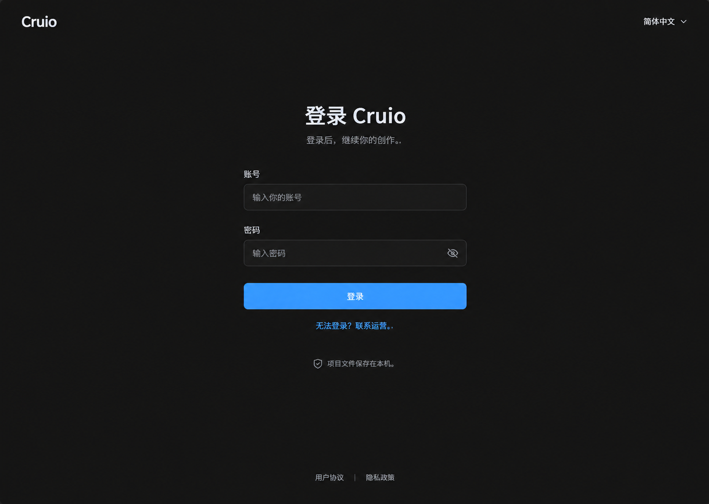
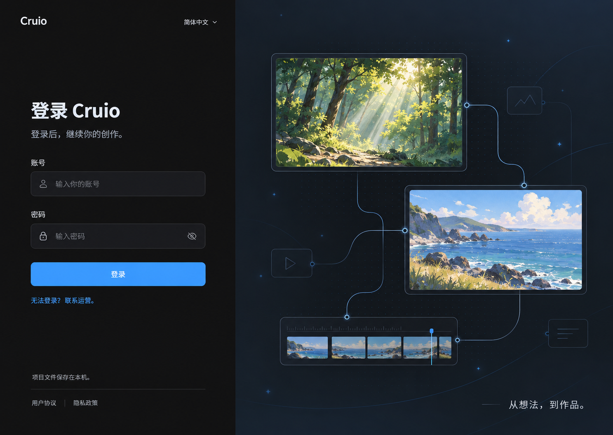
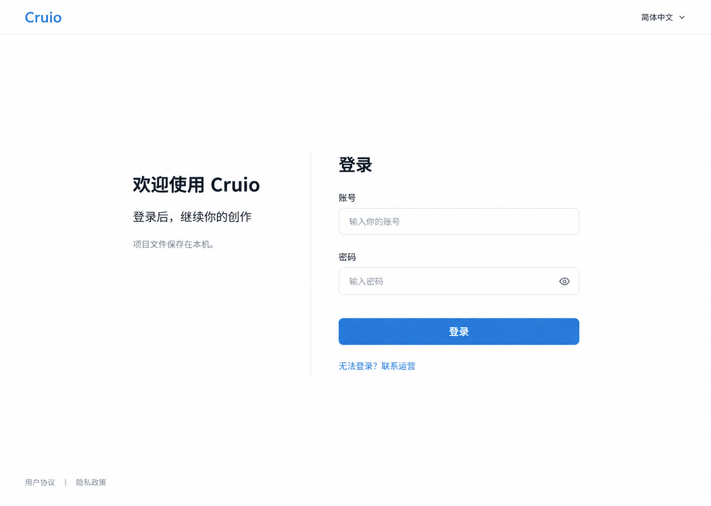

# Cruio 账户视觉方案

日期：2026-11-02。用户已选择第二张“创作入口”，对应 `visuals/creativeLogin.png`。第一、第三张作为探索留档；后续账户页面沿用第二张的深色表面、蓝色强调和圆角语言。图像由内置 ImageGen 生成，实际提示词见[生成记录](./imagePrompts.md)。

设计沿用现有桌面创作产品的深浅色主题、克制的蓝色强调、8px 基础圆角及设置分类结构。此次只设计账户相关区域，保留画布、素材库、编辑器与项目页面原有构成。

## 1 登录视觉方向

### 第一张 专注登录

表单直接放在深色页面上，内容集中在中间，只有一个主要操作。适合以低干扰、快速进入为目标的登录入口；不依赖品牌插画，后续维护最简单。

### 第二张 创作入口 已选定

左侧登录、右侧用通用创作画面与节点连接表达产品用途，延续现有引导页的分栏结构。右侧必须是固定品牌插画，不展示用户最近项目或真实内容；小窗口隐藏装饰区。

### 第三张 轻量工作台

使用现有浅色主题，顶部保留简洁应用栏，中部以介绍区和表单并列形成层次。适合偏好浅色界面的用户；它是布局方向的演示，不意味着取消深色主题。

已选定登录页的分栏布局和视觉层次；深浅主题仍应覆盖，第三张不作为已选方向的浅色定稿。创作插画限于登录入口，账户面板和异常弹窗复用现有工作区背景，不重做创作页面。账号密码及开发授权已由用户在后续单独确认；运营联系方式或正式 Logo 不由视觉稿决定。

运营后台另采用浅色表格与详情分区，绿色突出主操作，状态同时使用文字和颜色。只提供账户管理导航，不新增统计大屏或主题切换。实际视觉见 [adminPreview.jpg](./adminPreview.jpg)，图中为隔离验证账户，不是正式用户数据。

## 2 视觉基线

| 项目 | 现有依据 | 本次设计建议 |
| --- | --- | --- |
| 产品色 | 设置默认主色为 `#409EFF` | 保留蓝色身份；正文、链接和按钮按对比度采用合适色阶 |
| 基础圆角 | `main.scss` 的 `--ui-radius: 8px` | 输入与按钮 8px；对话框 12px；不引入大胶囊卡片体系 |
| 字体 | 现有引导使用 Inter、Segoe UI、PingFang SC、Microsoft YaHei | 沿用现有字体栈，不新增字体下载依赖 |
| 设置结构 | 分类栏 160px，对话框最大宽度约 1080px | 增加“我的账户”分类，复用内容区尺寸与滚动方式 |
| 图标 | 已有 Tabler 图标 | 使用已有用户、退出、显示密码及状态类图标，不绘制新图标体系 |
| 品牌 | Cruio 正式 Logo、图标和主色尚未最终确认 | 效果图用文字字标，不把 Toonflow 图形改字后当 Cruio Logo |

### 建议色值

以下是设计建议，属于角色色规范，不意味着当前源码已使用全部值。后续应映射到现有主题变量，避免另建平行主题。

| 角色 | 深色 | 浅色 |
| --- | --- | --- |
| 页面背景 | `#141414` | `#FFFFFF` |
| 次级表面 | `#1D1E1F` | `#F5F7FA` |
| 分隔线 | `#383B40` | `#E3E6EB` |
| 输入边界 | `#737780` | `#858D99` |
| 主要文字 | `#F2F3F5` | `#1D2129` |
| 次要文字 | `#A6ADB8` | `#626B78` |
| 主操作底色 | `#2475D0` | `#2475D0` |
| 主操作文字 | `#FFFFFF` | `#FFFFFF` |
| 链接和焦点 | `#66B1FF` | `#1C64B5` |
| 成功文字 | `#75D7A0` | `#216E43` |
| 警示文字 | `#F1C36D` | `#805600` |
| 错误文字 | `#FF9292` | `#B42318` |

效果图沿用了较亮蓝色主按钮来探索视觉，工程定稿需采用满足文字对比度的色阶。细分隔线不承担独立交互边界；输入框及焦点环使用更清楚的边界色。

### 字号与间距

| 元素 | 建议规格 |
| --- | --- |
| 登录主标题 | 32px，字重 600，行高约 1.35 |
| 设置面板标题 | 22px，字重 600 |
| 正文和输入 | 14–16px，行高约 1.5 |
| 字段标签 | 14px，字重 500 |
| 辅助说明 | 12–13px，保留足够对比度 |
| 字段高度 | 44–48px |
| 密码可见性等图标按钮 | 至少 40px 可点击区域 |
| 标签至输入 | 8px |
| 字段组间距 | 20–24px |
| 说明至表单 | 28–32px |
| 主按钮至次操作 | 16px |
| 表单宽度 | 360px，宽窗口可到 400px；窄窗口两侧保留至少 24px |

## 3 其他账户区域布局

“我的账户”“模型未开通”“会话失效”“退出确认”已按选定方向生成高保真图，见 [账户页面深化设计](./screenDesign.md)。下表仍作为布局规格，其余状态尚未逐一生成效果图。

| 页面 | 容器和层次 | 视觉处理 |
| --- | --- | --- |
| 会话恢复 | 启动页中心的 Cruio 字标与一行“正在恢复登录…” | 单一小型进度反馈；不闪现项目列表，不展示百分比假进度 |
| 我的账户 | 现有设置面板，依次为标题、身份信息行、模型服务行、退出行 | 信息以两列标签和值排列，使用轻分隔线；不新增嵌套卡片 |
| 模型未开通 | 模型服务行内提示区域 | 警示图标＋标题＋简短原因；联系运营为唯一主操作 |
| 会话失效 | 工作区上方约 420px 宽居中对话框 | 工作区保持可见，遮罩降低干扰；主操作重新登录，有修改时提供保存收尾 |
| 退出确认 | 约 420–480px 宽对话框 | 取消在左，主操作在右；仅放弃修改使用危险样式 |
| 网络中断 | 当前内容区顶部横幅 | 警示色点缀；说明当前受限能力，不覆盖整张画布 |
| 旧版数据导入 | 约 560px 宽对话框，条目列表 | 每行一个可导入类别、说明与选择状态；不用项目缩略图填充 |

账户信息只读时用文本，不做成看似可编辑的输入框。状态提示不展示后端接口、令牌 ID、数据库字段或供应商内部错误原文。

## 4 响应与可访问性

设计参考视口为 1440 × 1024。生成图保留工具原始尺寸和比例，不拉伸为工程尺寸。

- 宽度大于等于 1100px：按选定布局保留全部区域。
- 700–1099px：第二张的装饰区隐藏，第三张的说明与表单上下排列；表单优先保持完整。
- 小于 700px：单栏布局、24px 页面边距，帮助与协议链接正常换行，不产生横向滚动。这里是桌面窄窗口适配，不等于新增移动端产品范围。
- 高度不足时允许纵向滚动，主按钮和错误提示不能被固定页脚覆盖。
- 键盘焦点环 2px，可见性不依赖颜色变化或悬停；错误信息与字段关联。
- 文字放大时标签与说明自然换行，对话框内容滚动，操作区保持可到达。
- 过渡控制在约 120–180ms；减少动态效果偏好下取消装饰运动。登录背景不做无限动画。
- 以普通文字对比度不低于 4.5:1、关键控件边界和焦点不低于 3:1 为设计目标，实施时按实际组合验证。效果图不能替代可访问性验收。

## 5 文案与素材定稿边界

三张图中的账号密码表单是设计假设。帮助、协议和隐私链接没有在本轮连接真实目的地；正式上线前必须补齐内容或按最终服务能力调整。未确定 Logo 时不新造品牌图形。

生成图用于评审构图和视觉层次，个别标点、光影、字号及配色可能与规格不完全一致；实施以本文件和[页面文案](./productDesign.md)为准。第二张的背景图片仅为创作氛围素材，不代表产品承诺的作品质量或已生成的用户作品。

本轮只交付视觉方向及规范，不输出伪造的真实账户、用量、充值订单或后台管理界面。
